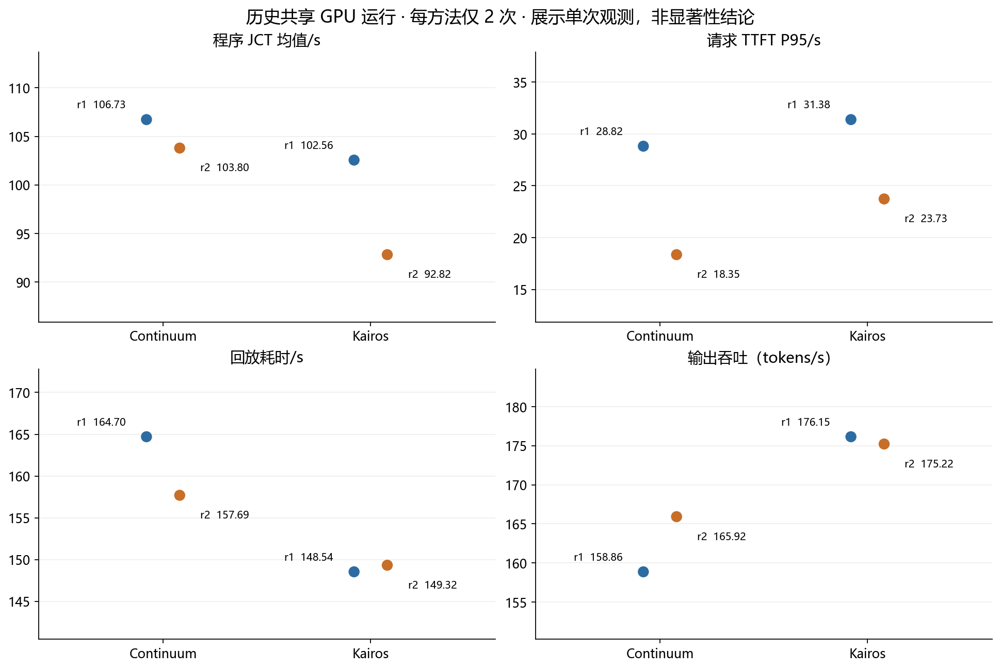
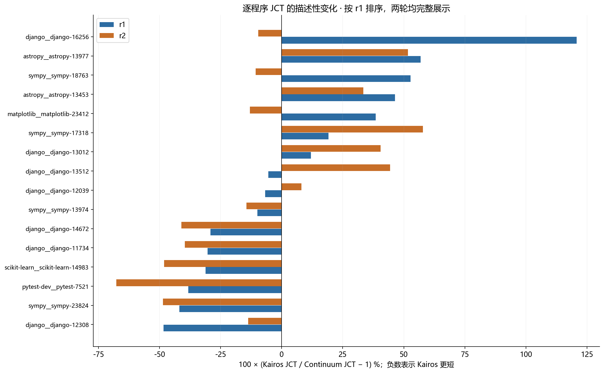

# 历史实验结果核对报告

整理人：万理（人员 C）｜日期：2026-11-02｜本次仅离线读取历史文件，没有运行新 GPU 实验。

## 1. 核心结论

现有材料支持“实现小组的两种方法均有完整回放的历史记录”，并呈现 Kairos 在平均程序完成时间和整段回放吞吐上的改善方向。但两种方法各只有 2 次运行，且实现小组明确记录四次都遇到邻居 GPU 进程；不能据此宣布独占条件下的稳定收益、显著提升或最终最优工作负载。

- 两轮同编号对照中，Kairos 平均程序 JCT 分别变化 -3.91%、-10.57%（负数为时间缩短）。
- 输出吞吐分别变化 +10.88%、+5.61%。
- **代价同样存在：** P95 TTFT 分别变化 +8.90%、+29.28%；两轮都更慢。平均指标改善不代表尾部延迟全面改善。
- 本次复算的 68 项算术/记录一致性检查，通过 68 项，失败 0 项。范围是已保存字段，不是完整逐请求或 GPU 资源审计。

## 2. 分析对象和证据层级

来源为实现仓库 `Kadsoo/AI-infra-project` 的本地固定提交 `4f4c600367b02b82b389689b9a7ece2b2af4c4b9`，目录 `tasks/continuum/results_cloud/kairos_3way/`。未重新拉取远端，也没有登录服务器找缺失日志。

本地 [source](source) 保存了该目录的 12 个 JSON 和依赖快照，以及 SUMMARY、REPRO、wrapper 原文。文件指纹在 [历史结果明细.json](历史结果明细.json) 中。

| 材料 | 本次是否取得 | 能支持什么 |
|---|---|---|
| 每轮 summary / state / jobs | 是，共 4 轮各 3 个文件 | 运行状态、汇总数字、逐程序 JCT 及部分配置的一致性 |
| 环境 freeze、REPRO | 是 | 历史依赖与启动方法的交接记录，不是本机实时环境 |
| requests.jsonl | 否 | 无法独立复算 TTFT/E2E/ITL，无法逐请求核实无遗漏与实际输出预算 |
| resources.json / FOREIGN_LOG | 否 | 无法独立复算 GPU 峰值或干扰次数、持续时间及时间窗交叠 |
| launch、调度/传输原始日志 | 否 | 无法审计实际命令、CPU 亲和、KV 参数、缓存命中及 TTL 分布 |

目录名虽然是 `kairos_3way`，实际归档只有 continuum 和 kairos 两种方法。SUMMARY 已说明 fixed/zero 的环境变量消融没有生效，不能将这些运行当作三个有效实验组。

此前 Kairos 上游自身的原始归档，以及本仓库更早的 Qwen2.5-3B V0/V1/OFF、CPU 仿真结果，属于不同实验批次和配置，本报告不把它们混为本次重复样本。

## 3. 四次运行的原始指标

r1 指文件名没有 `_r2` 的那次运行。表中百分比为 `100 × (Kairos / Continuum − 1)`，仅按同编号作描述性对照，未证实随机化或严格成对实验设计。

| 指标 | Continuum r1 | Kairos r1 | Continuum r2 | Kairos r2 | r1 相对变化 | r2 相对变化 |
|---|---:|---:|---:|---:|---:|---:|
| 程序 JCT 均值/s | 106.726 | 102.556 | 103.795 | 92.821 | -3.91% | -10.57% |
| 程序 JCT P95/s | 158.694 | 142.705 | 149.501 | 144.514 | -10.08% | -3.34% |
| 请求 TTFT 均值/s | 5.137 | 4.441 | 5.002 | 3.711 | -13.55% | -25.81% |
| 请求 TTFT P95/s | 28.817 | 31.383 | 18.354 | 23.728 | +8.90% | +29.28% |
| 请求 E2E 均值/s | 9.078 | 8.703 | 8.815 | 7.829 | -4.13% | -11.19% |
| 请求 E2E P95/s | 30.379 | 33.645 | 25.575 | 26.159 | +10.75% | +2.28% |
| 回放耗时/s | 164.702 | 148.535 | 157.694 | 149.323 | -9.82% | -5.31% |
| 输出吞吐（tokens/s） | 158.857 | 176.146 | 165.916 | 175.217 | +10.88% | +5.61% |

四次 summary 都记录完成 178 请求、失败 0、完成 16 程序，state 均为 complete。这里只能称“归档记录如此”，不能用 summary 替代缺失的逐请求验证。

程序 JCT 包含程序内工具等待、排队和计算，不含到达之前等待；wall 是回放时间，不含加载、编译和预热。输出吞吐使用整个回放 wall 作为分母，不能当成纯 decode 服务速度。ITL 的上游实现只使用相邻单 token 流块，本报告不把该采样当作完整逐 token 延迟。

没有合并两次运行的 P95，也没有给 n=2 制造可靠置信区间。下面仅展示观测范围；它不是估计出的总体波动范围。

| 方法 | 指标 | 两次观测范围 |
|---|---|---|
| continuum | 单次运行的平均 JCT/s | 103.795～106.726 |
| continuum | 单次运行的 P95 TTFT/s | 18.354～28.817 |
| kairos | 单次运行的平均 JCT/s | 92.821～102.556 |
| kairos | 单次运行的 P95 TTFT/s | 23.728～31.383 |

## 4. 逐程序是否一致受益

同编号对照中，r1 有 9/16 个程序 JCT 下降，r2 有 10/16 个下降；有 5 个程序的改善/退化方向在两轮之间变化。这提示要保留逐程序结果，不能只报告整体均值。

| 程序 | C r1/s | K r1/s | r1 变化 | C r2/s | K r2/s | r2 变化 |
|---|---:|---:|---:|---:|---:|---:|
| django__django-12308 | 107.14 | 55.37 | -48.3% | 110.09 | 95.06 | -13.7% |
| sympy__sympy-23824 | 143.64 | 83.44 | -41.9% | 138.60 | 71.21 | -48.6% |
| pytest-dev__pytest-7521 | 123.99 | 76.58 | -38.2% | 126.19 | 40.78 | -67.7% |
| scikit-learn__scikit-learn-14983 | 157.63 | 108.47 | -31.2% | 147.71 | 76.57 | -48.2% |
| django__django-11734 | 152.02 | 106.02 | -30.3% | 142.70 | 86.21 | -39.6% |
| django__django-14672 | 86.45 | 61.27 | -29.1% | 78.87 | 46.52 | -41.0% |
| sympy__sympy-13974 | 161.89 | 145.73 | -10.0% | 154.89 | 132.60 | -14.4% |
| django__django-12039 | 73.10 | 68.16 | -6.8% | 76.15 | 82.36 | +8.2% |
| django__django-13512 | 121.44 | 114.84 | -5.4% | 99.59 | 143.82 | +44.4% |
| django__django-13012 | 126.57 | 141.70 | +12.0% | 104.33 | 146.60 | +40.5% |
| sympy__sympy-17318 | 69.21 | 82.46 | +19.1% | 63.26 | 99.80 | +57.8% |
| matplotlib__matplotlib-23412 | 98.81 | 136.88 | +38.5% | 117.30 | 102.06 | -13.0% |
| astropy__astropy-13453 | 83.23 | 121.89 | +46.4% | 90.20 | 120.39 | +33.5% |
| sympy__sympy-18763 | 79.05 | 120.81 | +52.8% | 84.78 | 75.74 | -10.7% |
| astropy__astropy-13977 | 86.50 | 135.75 | +56.9% | 83.90 | 127.30 | +51.7% |
| django__django-16256 | 36.94 | 81.54 | +120.7% | 42.17 | 38.12 | -9.6% |

此表按程序 ID 对齐，避免把 jobs 文件中的完成顺序误当作相同任务的顺序。16 个程序共享同一运行环境，不应把它们当作 16 次独立硬件重复试验。

## 5. 可复算检查与配置核对

本次核对：state/summary 方法及嵌入摘要一致、16 个程序 ID 无遗漏和重复、每程序轮数与归档 trace 一致；从 jobs 复算 JCT 均值与线性插值 P95；核对时间差、工具等待总和、trace 文件哈希及吞吐算术关系。

吞吐乘 wall 分别与 178 请求、26,164 计划输出 tokens、941,797 输入加计划输出 tokens 一致。这是汇总算术自洽，仍不能代替逐请求核实实际 token 数。

| state 中记录的字段 | 四轮是否一致 |
|---|---|
| gpu | 一致 |
| packages | 一致 |
| profile_sha256 | 一致 |
| reload_sha256 | 一致 |
| trace_sha256 | 一致 |
| expected_model_revision | 一致 |
| verified_model | 一致 |

state 中记载相同 GPU UUID、24,564 MiB 总显存、相同模型 revision `b968826d9c46dd6066d109eabc6255188de91218`、相同 trace/profile/reload 哈希与依赖组合。相同配置指纹是可比性的必要证据之一，不足以证明执行时完全公平。

GPU used/util 的 0 是启动时快照，**不能证明整个回放期间无邻居进程，也不是显存峰值**。`weights_verified=true` 是历史校验记录，本次没有读取服务器上的权重重新验证。state 没有提供源码 commit；Kairos `7971fa4` 的版本对应关系来自 REPRO 交接说明。

| 运行 | 回放开始（北京时间） | 回放结束（北京时间） | state 生命周期/s |
|---|---|---|---:|
| continuum | 2026-10-27T11:15:44+08:00 | 2026-10-27T11:18:29+08:00 | 308.85 |
| kairos | 2026-10-27T11:25:03+08:00 | 2026-10-27T11:27:31+08:00 | 296.24 |
| continuum_r2 | 2026-10-27T12:29:17+08:00 | 2026-10-27T12:31:55+08:00 | 309.79 |
| kairos_r2 | 2026-10-27T12:39:17+08:00 | 2026-10-27T12:41:47+08:00 | 292.54 |

时间由文件 Unix 时间戳转换为 UTC+08:00；不使用本机默认时区。生命周期从 state.started_at 到 ended_at，与纯回放 wall 分开记录。

## 6. 干扰证据及缺口

SUMMARY §7 声称回放窗内邻居进程 sightings 分别为 continuum r1 76、r2 73、kairos r1 69、r2 69。**这些是文字报告值，本地没有对应 foreign 原始日志，无法复算。** Sightings 是采样发现次数，不是唯一进程数、GPU 占用率或占用时长。

SUMMARY 写“原始 JSON 与 foreign 日志在目录中”，但本次固定提交中实际只找到前述文件；不能据此假装已核实干扰日志。邻居干扰也不能被精确量化或从总时间中扣除。

REPRO 的 wrapper 在内存中修改进程归属检查，将 foreign 集合并入 own，再返回空 foreign 集合。因此不能凭 wrapper 运行中 resources 的 foreign 字段为空来证明无干扰。每次都需要独立 FOREIGN_LOG 与准确回放窗；本次连 resources 文件也未归档。

从四次观测可描述改善方向，但无法证明差异显著，也无法证明差异完全由干扰造成。两者都需要更完整的证据。

## 7. 供后续复跑使用的问题清单

| 优先级 | 问题 | 现在能做什么 / 后续如何处理 |
|---|---|---|
| 高 | 四次运行有共享 GPU 干扰报告，原始证据未提供 | 当前结果标为探索性；正式比较预约独占时段并保留进程监控 |
| 高 | 缺逐请求日志 | 未来保存 requests.jsonl，并核对唯一请求集合、error 和实际输出预算 |
| 高 | 缺 launch / 资源 / 传输日志 | 每轮保存整个输出目录，运行前记录资源与 CPU 亲和；失败目录也保留 |
| 高 | 当前实例 30GB 标注与原版 40GiB 可用内存要求冲突 | 保留为上机前核查项，离线报告不能解决资源可用性 |
| 中 | 每方法只有 2 次，无随机运行顺序证据 | 新实验至少各 3 次独立运行，预先安排交替/平衡顺序，按实际变异再决定是否增加 |
| 中 | 尾部延迟退化被平均值掩盖 | 同时报告平均 JCT、P95 TTFT/E2E、吞吐和逐程序退化情况 |
| 中 | fixed/zero 消融无效 | 正式实现支持之前不报告三方消融；不沿用无效环境变量设置 |
| 中 | SUMMARY 混有旧 3B/Python3.10 环境段落 | 本轮以 state 依赖与 REPRO 的 Qwen3-8B/Python3.12 记录为准，避免混配 |

这些待补齐项不要求现在开机或联系他人；本报告先固定已有证据和缺口，供下一次上机使用。

## 8. 本次交付与复算

- [历史结果明细.json](历史结果明细.json)：全部数值、逐程序变化、检查结果及输入哈希。
- [analyze_history.py](analyze_history.py)：在本地运行 `python analyze_history.py` 重新生成报告和图表；需要 matplotlib。读取已保存 source 与上一步归档 trace，不运行其中的 wrapper。
- [SUMMARY 原文](source/SUMMARY.md)、[REPRO 原文](source/REPRO.md)、[wrapper 原文](source/run_relaxed.py)。
- [实现仓库固定版本目录](https://github.com/Kadsoo/AI-infra-project/tree/4f4c600367b02b82b389689b9a7ece2b2af4c4b9/tasks/continuum/results_cloud/kairos_3way)。

本次完成的是历史资料审查，尚未完成独占复跑、最终工作负载选择或新模型适配。
