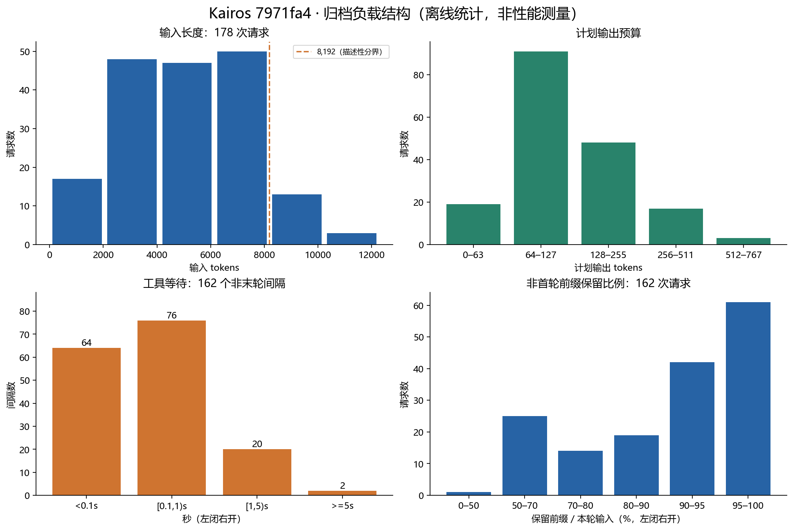
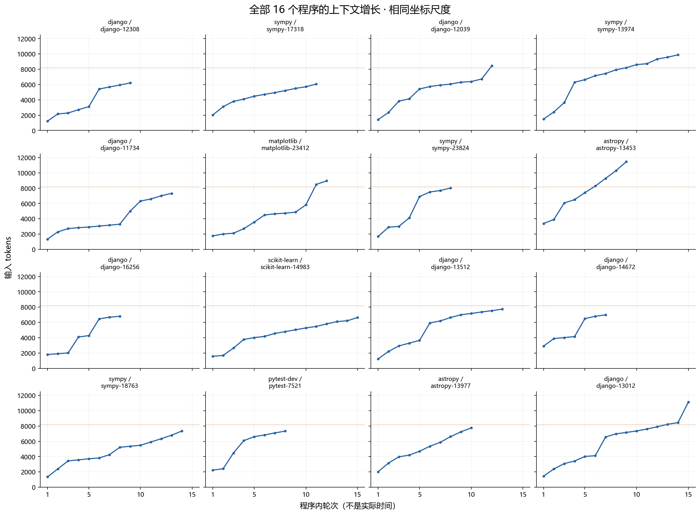
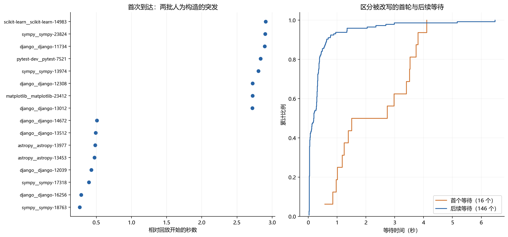

# 现有负载分析报告

分析人：万理（人员 C）｜日期：2026-11-02｜范围：本地静态数据分析，未开机、未运行模型。

## 1. 结论

这份负载适合作为首次接手复跑和缓存竞争机制观察的起点：16 个完整多轮程序、178 次请求，存在较长上下文、较高的前缀保留，以及两批集中到达的程序。但它是经过选择与到达/首个等待改写的 SWE teacher 压力负载，不能独自代表生产流量，也不能据此宣布已确定最适合 24GB 的最终负载。

- **长输入集中在少数程序的后期请求。** 输入至少 8,192 tokens 的请求有 16/178（9.0%），涉及 5/16 个程序，其余大多数请求低于此长度。8,192 是本报告的描述性分界，不是硬件容量线。
- **续轮存在明显的复用机会。** 非首轮显式保留前缀的 token 加权比例为 88.74%；这不是实测缓存命中率。
- **工具等待以短间隔为主。** 小于 1 秒的等待为 140/162（86.4%），至少 5 秒的仅 2 个；未覆盖分钟级等待。
- **首次到达高度集中。** 8 个程序在 1 秒内到达，其余 8 个在约 2.7～2.9 秒到达。这是构造的突发，不能从到达时间推算真实并发或返回时刻。

## 2. 数据版本、来源与重要纠正

分析对象为 Kairos 提交 `7971fa40323f16e8e4ce8f12dfd5db9755a98cf1` 的 `data/workload/trace.json`，SHA256：

`4c896b93b14eff39bcc6e2fd0700ba59a1bfcfd785bd15e645d5e1a2ffeee2e8`

本地已保留 [原始 trace 副本](source/trace.json)、[EXPERIMENTS.md](source/EXPERIMENTS.md)、[THIRD_PARTY.md](source/THIRD_PARTY.md) 和 [历史 tokenizer 核验记录](source/tokenizer-verification.json)，便于复查。

据固定版本 THIRD_PARTY，来源为 `tarsur385/qwen3-30b-a3b-instruct-2507-swebench-verified-mini-swe-agent`，revision `58389eb5426db5a3ae6159faa37498072b4735ff`。本次没有重新下载原始数据或验证其全量覆盖范围。

EXPERIMENTS 将实际负载命名为 `dense_return_burst_production_v1`：保留 SWE teacher 多轮内容，改写首次到达和首个工具等待，构造首轮/续轮竞争，目标首个工具返回窗口靠近 4.8 秒。实际返回仍取决于模型服务时间。

**纠正此前准备文档的表述：** 回放器 summary 中通用的 `synthetic token identity` 标签不足以证明当前归档的 token 全为合成。具体归档文档说明使用原 teacher 输入，且历史记录显示 178 次输入在 8B tokenizer 上核对一致。本报告以具体负载数据、构造说明和历史核验记录为依据；本次未重做 tokenizer 验证。

文件头的 Qwen3-4B 路径、Poisson、0.48 program/s、旧资源容量及部分统计是生成阶段遗留信息。以下数字全部从 `programs` 重算，不采用它们。`source_gap_s` 也是归档中的来源字段，不能在未回溯原始轨迹时保证它就是未经处理的真实等待。

## 3. 统计口径

- 逐程序从空输入开始，以 `previous[:keep_prefix_tokens] + added_token_ids` 重建每轮输入；核对声明长度。
- 输出长度是固定生成预算，不是本次实际模型输出；回放不将本次生成的回答自动拼入后续输入。
- 等待仅统计非末轮的 162 个间隔；末轮 gap 不参与实际等待。等待总和不能当作整体墙钟耗时，因为程序之间可能重叠。
- 输入/输出按请求统计，前缀比例排除 16 个首轮；加权前缀比例为保留 token 总和 / 非首轮输入 token 总和。
- P95 为 nearest-rank，中位数为普通样本中位数。此口径与仓库性能报告的插值 P95 不同，不混用。

## 4. 长度、输出与等待分布

| 项目 | 最小 | 中位数 | P95 | 最大 |
|---|---:|---:|---:|---:|
| 输入 tokens | 1,218 | 5,247.5 | 8,727 | 11,455 |
| 计划输出 tokens | 39 | 104.0 | 390 | 699 |

输入少于 4,096 tokens 有 65 次；4,096～8,191 有 97 次；至少 8,192 有 16 次，其中至少 10,240 有 3 次。

总计划输出 26,164 tokens；输出至少 256 tokens 的请求有 20 次。最长上下文程序为 `astropy__astropy-13453`，最多计划输出的程序为 `astropy__astropy-13977`（累计 2,437 tokens）。两者不必是同一个程序，输入缓存压力和解码工作量应分开讨论。

单请求最大“输入 + 输出预算”为 11,717 tokens，低于该固定发布记录的 16,384 上下文上限；这只说明长度合同可容纳，不证明同时并发时显存充足。

| 统计对象 | 样本数 | 最小 | 中位数 | P95 | 最大 |
|---|---:|---:|---:|---:|---:|
| 所有工具等待（秒） | 162 | 0.026 | 0.276 | 2.977 | 6.477 |
| 首个工具等待（秒） | 16 | 0.569 | 2.120 | 4.104 | 4.104 |
| 后续工具等待（秒） | 146 | 0.026 | 0.185 | 1.339 | 6.477 |

等待区间计数：<0.1s: 64; [0.1,1)s: 76; [1,5)s: 20; >=5s: 2。短等待有利于观察快速返回时缓存是否仍被保留；长等待更能暴露驻留成本与恢复取舍。这里的短等待集中性意味着不能据此概括长工具任务的表现。

## 5. 哪些程序增长快、潜在压力大

下表按最大输入排序；平均增长为“末轮输入减首轮输入 / 续轮次数”，不是 tokens/秒。横轴是轮次，不是实际执行时间。

| 程序 | 轮数 | 首轮 → 末轮输入 | 平均每续轮增长 | 最大单轮增长 | 总输出预算 | 工具等待总和/s | 续轮加权前缀比例 |
|---|---:|---:|---:|---:|---:|---:|---:|
| astropy__astropy-13453 | 9 | 3,384 → 11,455 | 1009 | 2,153 | 1,065 | 7.58 | 87.2% |
| django__django-13012 | 15 | 1,447 → 11,118 | 691 | 2,675 | 2,313 | 6.41 | 89.0% |
| sympy__sympy-13974 | 14 | 1,491 → 9,884 | 646 | 2,659 | 2,358 | 13.90 | 91.2% |
| matplotlib__matplotlib-23412 | 12 | 1,764 → 8,952 | 653 | 2,666 | 1,749 | 1.25 | 86.2% |
| django__django-12039 | 12 | 1,415 → 8,459 | 640 | 1,731 | 1,855 | 4.90 | 88.4% |
| sympy__sympy-23824 | 8 | 1,690 → 8,016 | 904 | 2,789 | 1,362 | 2.59 | 84.2% |
| astropy__astropy-13977 | 10 | 2,028 → 7,754 | 636 | 1,135 | 2,437 | 3.99 | 88.2% |
| django__django-13512 | 13 | 1,235 → 7,734 | 542 | 2,280 | 1,676 | 14.23 | 90.3% |
| sympy__sympy-18763 | 14 | 1,350 → 7,348 | 461 | 1,051 | 2,208 | 4.71 | 90.5% |
| pytest-dev__pytest-7521 | 8 | 2,236 → 7,333 | 728 | 2,068 | 1,100 | 1.11 | 87.5% |
| django__django-11734 | 13 | 1,341 → 7,323 | 498 | 1,714 | 1,871 | 3.81 | 88.5% |
| django__django-14672 | 7 | 2,903 → 6,985 | 680 | 2,344 | 913 | 6.69 | 87.3% |
| django__django-16256 | 8 | 1,798 → 6,794 | 714 | 2,184 | 917 | 4.21 | 84.4% |
| scikit-learn__scikit-learn-14983 | 15 | 1,569 → 6,637 | 362 | 1,120 | 1,675 | 5.40 | 92.3% |
| django__django-12308 | 9 | 1,218 → 6,209 | 624 | 2,302 | 1,148 | 4.40 | 85.0% |
| sympy__sympy-17318 | 11 | 2,026 → 6,056 | 403 | 1,089 | 1,517 | 5.97 | 91.5% |

- 最大上下文：`astropy__astropy-13453`，11,455 tokens。
- 平均增长最快：`astropy__astropy-13453`，每个续轮约 1009 tokens。
- 最大单轮跳增：`sympy__sympy-23824`，新增 2,789 tokens。
- 观察到显式前缀截短 162 次，但全部只去掉上轮输入末尾 4 tokens，再追加本轮内容；输入长度下降 0 次。这是很小的尾部变动，不能称为大量历史截断。未解码这些 token，本报告不推断它们的语义。

输入越长通常需要容纳更多 KV，但真实驻留量还取决于生成、缓存淘汰、页布局、活跃请求及两层缓存策略。以上只是优先观察对象，不是 OOM 风险排序或实测峰值。

16 个末轮输入总和为 128,057 tokens。它不是同一时刻的驻留集合，不可直接与 24GB 比较。不同程序的 cache_salt 共 16 个，不能假设程序间共享前缀一定会带来跨程序命中。

## 6. 到达结构、首轮改写与工具类型

所有程序 predecessor 均为空：本负载没有跨程序串行依赖；但每个程序内部必须等上一轮完成并等待工具间隔才能提交下一轮。即使首次到达都在约 3 秒内，也不能当成持续到达的生产流量，更不能把累计到达数当成实际服务并发。

`gap_after_s` 与归档 `source_gap_s` 数值不同的非末轮间隔有 0 个。两字段当前完全相同并不能证明等待未经改写：frontier 与实验说明明确记录了首个等待的改写。当前归档无法仅靠这两个字段恢复改写前的首个等待；还需原始来源数据。

非末轮工具标签（程序如何标记，报告就如何统计；不把标签当作独立执行过的工具）：

| 工具标签 | 间隔数 | 比例 |
|---|---:|---:|
| cat | 59 | 36.4% |
| grep | 23 | 14.2% |
| ls | 20 | 12.3% |
| find | 18 | 11.1% |
| sed | 15 | 9.3% |
| git | 12 | 7.4% |
| python | 4 | 2.5% |
| cd | 4 | 2.5% |
| pip | 3 | 1.9% |
| cp | 3 | 1.9% |
| mv | 1 | 0.6% |

数据来自软件工程任务，不能因标签多样就认定覆盖检索、数据库、网页或其他 Agent 场景。轨迹中的命令只作为数据读取，本次没有执行。

## 7. 对负载选型的建议与覆盖缺口

| 判断 | 数据依据 | 后续如何验证 |
|---|---|---|
| 保留为接手基线 | 已有固定版本、完整多轮结构和历史运行记录 | 在目标实例复跑并检查完整性 |
| 可用于缓存竞争观察 | 高前缀保留、集中到达、续轮上下文增长 | 采集实际缓存命中、传输、驻留和延迟 |
| 不足以代表自然流量 | 双批到达与首个等待被构造，非盲测 | 后续补充未改写到达/工具等待的可追溯样本 |
| 长等待覆盖不足 | 最长等待不到 7 秒 | 后续补充真实长工具等待；人工缩放另列为合成对照 |
| 前缀变化覆盖需扩展 | 所有续轮仅去掉上轮尾部 4 tokens，输入持续增长 | 后续补充低复用、大量历史截断或重写场景 |
| 模型及场景结论有限 | 单一固定 8B 回放与 SWE 场景，输出预算预先给定 | 新模型须适配；未知输出长度和自主 Agent 另设评测 |

现阶段可提出的推荐是：**先以这份 8B 固定归档作为复跑基线，再选择有明确差异的新负载做补充。** 不能仅凭静态数据选择最终并发、CPU KV 容量或宣称 4B/8B 哪个更优。

仍需上机回答：实际显存峰值、容器内存是否满足要求、稳定负载范围、缓存命中和传输量、延迟与吞吐，以及 Kairos/Continuum 的差异。

## 8. 交付与复算

- [完整统计与逐请求明细](analysis.json)：含逐程序、逐轮数值，便于后续筛选。
- [本地复算脚本](analyze_workload.py)：需要 Python 与 matplotlib；默认读本目录 source/trace.json，输出到本目录。不连接服务器。
- 在此目录运行：`python analyze_workload.py`。脚本按本次已冻结数据结构分析，不替代后续通用 Replay 验收工具。
- [固定版本实验说明](https://github.com/MaxizYB/Kairos/blob/7971fa40323f16e8e4ce8f12dfd5db9755a98cf1/docs/EXPERIMENTS.md)、[来源说明](https://github.com/MaxizYB/Kairos/blob/7971fa40323f16e8e4ce8f12dfd5db9755a98cf1/THIRD_PARTY.md)。本次读取本地固定副本，未重新核实远端最新状态。
